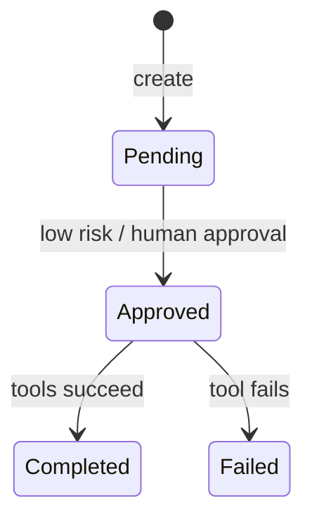

# Agent Control Plane

[](https://github.com/borikhan/agent-control-plane/actions/workflows/ci.yml)
[](https://www.typescriptlang.org/)

A TypeScript control plane for executing agent workflows without giving an LLM unrestricted authority. Tools must be explicitly registered, high-risk steps require human approval, and every lifecycle transition is captured in an audit trail.

## Core properties

- Default-deny tool registry blocks unrecognized capabilities
- Risk is attached to each step; high-risk workflows cannot run before approval
- Sequential execution produces predictable ordering and stops on failure
- Audit events cover creation, approval, tool use, completion, and failure
- Strict TypeScript, Node's native test runner, CI, and a non-root container



## Run it

```bash
npm ci
npm run build
npm test
npm run dev
```

The HTTP API exposes workflow creation, approval, execution, inspection, and audit retrieval. See [architecture and operations](docs/architecture.md) for trust boundaries, persistence design, and twelve-factor deployment.

## License

MIT
